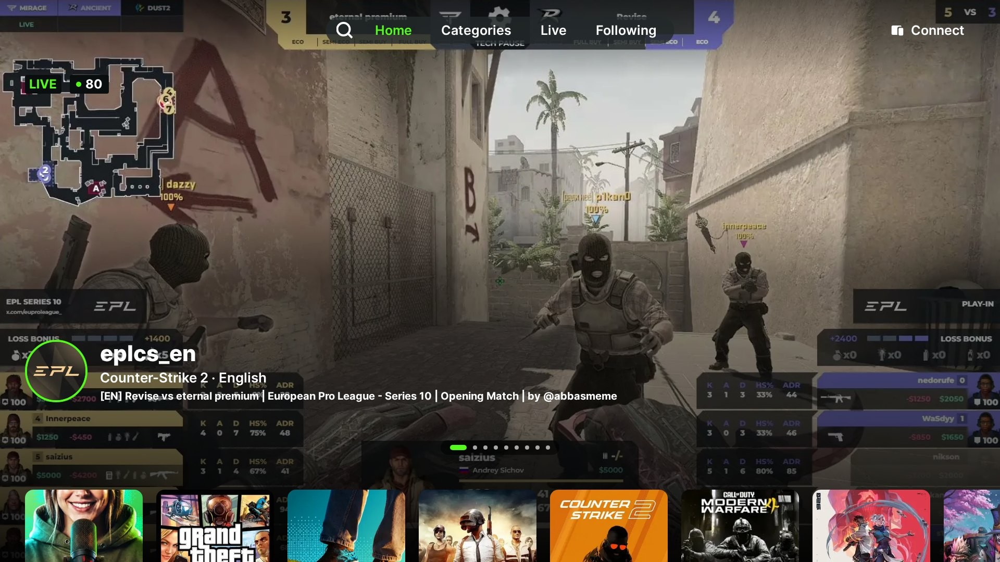
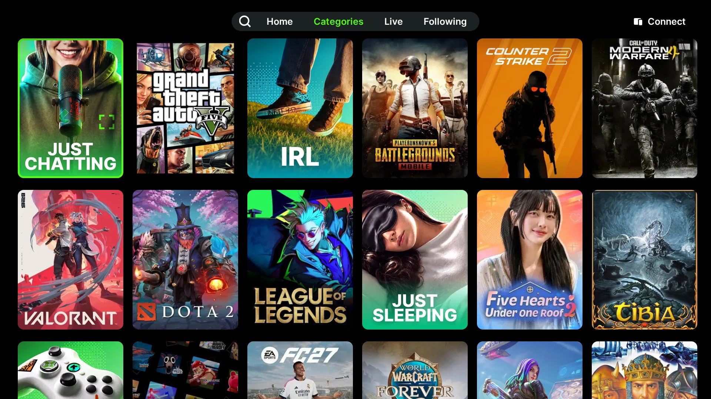
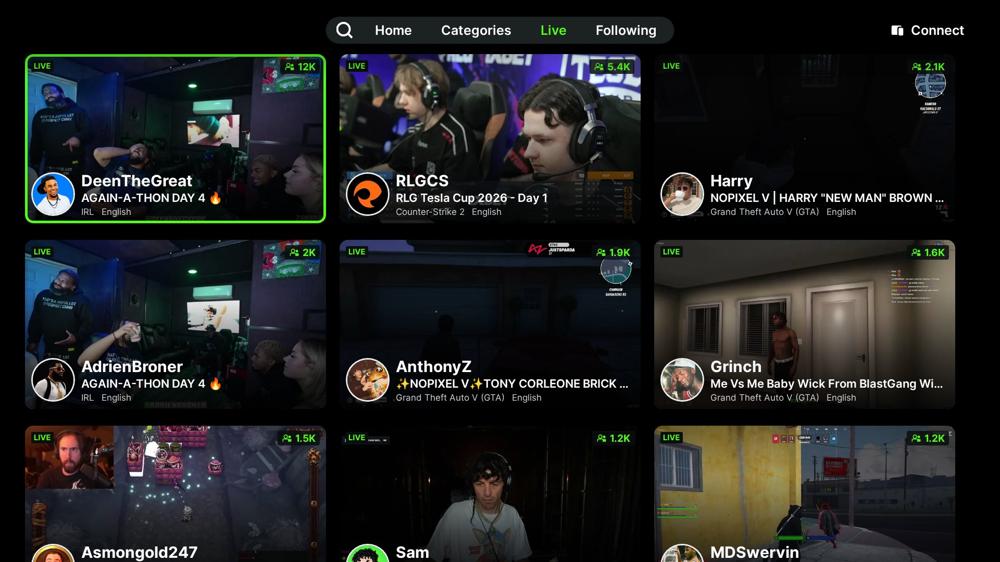
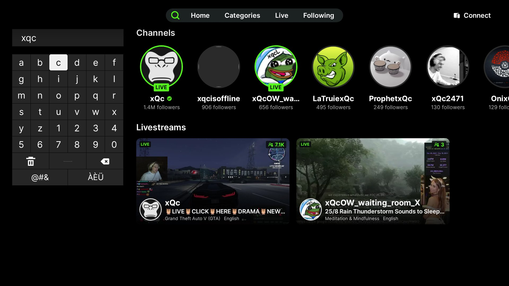

<div align="center">


### Kick for Samsung Smart TVs

Live streams, clips and chat on Tizen TVs, with the look and feel of Kick's Android TV app.


-53FC18?style=flat-square&labelColor=0B0E0F)

-555?style=flat-square)



</div>

## Features

- **Watch live** with chat, resolution choice and **rewinding** of the running stream
- **Home, Categories, Live, Following and Search**, in the layout of Kick's TV app
- **Streamer pages** with clips and recent broadcasts
- **Sign in with a QR code**, approved in the Kick phone app
- **Fast on old TVs**: a background helper caches video and skips the TV's slow name lookups
- **10 languages**: English, Español, Deutsch, Português, Français, 中文, 日本語, 한국어, हिन्दी, العربية
- **Content settings**: content language, hide gambling streams, hide 18+ streams

## Screenshots

| | |
|:---:|:---:|
|  |  |
| Categories | Live |
|  | |
| Search | |

## Compatibility

| Tizen | Samsung TVs | Status |
|---|---|---|
| 5.0 | 2019 | ✅ Tested (RU7379) |
| 4.0 | 2018 | Should work, not tested yet |
| 5.5 and newer | 2020+ | Should work, not tested yet |
| 2.3 – 3.0 | 2015 – 2017 | Not supported |

## Install on a TV

1. Download `Kick-<version>.wgt` from the [latest release](../../releases/latest).
2. On the TV, open **Apps**, type `12345` with the remote, switch **Developer Mode** on, and enter
   your PC's IP address. Restart the TV.
3. Sign and install the package with a Samsung certificate made for your TV, for example with
   Tizen Studio or the AeroTizen CLI:

   ```
   aerotizen --tv <tv-ip> install Kick-1.0.0.wgt
   ```

The package is unsigned on purpose: Samsung TVs only install apps signed for that particular TV.

## Build

```
python3 build.py
```

This packages `app/` as `dist/Kick-<version>.wgt` (the version comes from `app/config.xml`).
There is nothing to compile: the app is plain ES5 for the TV's old browser engine.

> [!IMPORTANT]
> Certificates and signature files are listed in `.gitignore`. Never commit them.

## How it works

`service/helper.js` is a small background service that starts with the app and listens only on
`127.0.0.1` (port 47820, and 47821 for pictures). It exists because:

- The TV's media player can't read Kick's gzip-compressed playlists.
- The TV looks up every new server name in 5–10 s; the helper does it in ~50 ms.

On top of that it keeps connections open, caches video segments in memory (48 MB), reads ahead
about 24 s in clips and videos, and starts rewinds right at the chosen point of the recording.
It only fetches from `*.kick.com` and Kick's video CDN (`*.live-video.net`), over HTTPS.

## Project layout

| Path | What |
|---|---|
| `app/` | The Tizen web app (`config.xml`, `index.html`, `js/`, `css/`, `img/`, `fonts/`) |
| `app/service/helper.js` | The background helper service |
| `app/js/i18n-data.js` | All translations (Kick's own where the official app has the same text) |
| `build.py` | Packages `app/` as a `.wgt` |
| `docs/screenshots/` | The pictures in this README |

## Credits

- [Inter](https://rsms.me/inter/) typeface: SIL Open Font License 1.1 (`app/fonts/OFL.txt`)
- [qrcode-generator](https://github.com/kazuhikoarase/qrcode-generator) by Kazuhiko Arase: MIT

---

<sub>Not affiliated with Kick. The Kick name, logo, icons and translations taken from Kick's app
belong to Kick.</sub>
